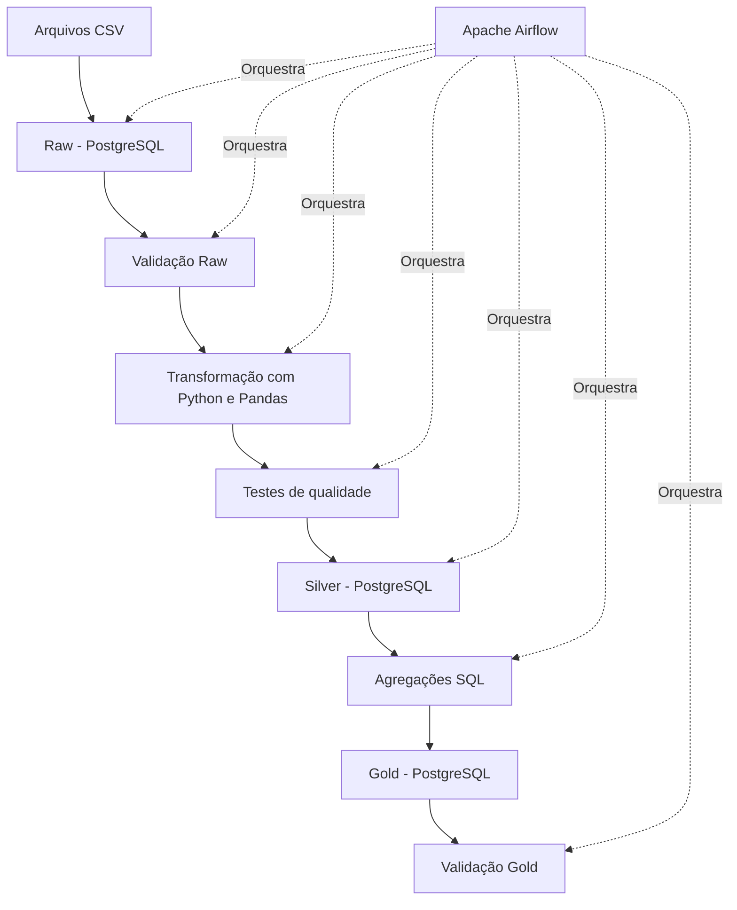

# Sales Data Platform

Pipeline de Engenharia de Dados desenvolvido com Python, PostgreSQL, Docker e Apache Airflow para ingestão, transformação, validação e agregação de dados de vendas.

## Objetivo

Construir uma plataforma de dados que processe informações de clientes, produtos e pedidos, aplicando regras de qualidade e disponibilizando dados estruturados para análises de negócio.

O projeto demonstra conceitos de ETL, modelagem de dados, orquestração de workflows, testes automatizados e validação de indicadores analíticos.

## Arquitetura



## Tecnologias utilizadas

| Tecnologia | Aplicação |
|---|---|
| Python | Ingestão, transformação e validação de dados |
| Pandas | Manipulação e tratamento de dados |
| PostgreSQL | Armazenamento das camadas analíticas |
| SQL | Consultas, agregações e validações |
| Apache Airflow | Orquestração do pipeline |
| Docker e Docker Compose | Containerização e ambiente de execução |
| pytest | Testes automatizados de qualidade |
| Git | Controle de versão |

## Camadas de dados

### Raw

Camada de entrada dos dados provenientes de arquivos CSV.

- Clientes (`customers`)
- Produtos (`products`)
- Pedidos (`orders`)

### Silver

Camada de dados tratados e estruturados.

- Padronização de campos textuais e status.
- Conversão e validação de datas e valores numéricos.
- Validação de quantidades e preços positivos.
- Cálculo do valor bruto de cada pedido.
- Persistência das tabelas tratadas no PostgreSQL.

### Gold

Camada analítica com tabelas agregadas por SQL.

| Tabela | Finalidade |
|---|---|
| `gold.sales_daily_sql` | Indicadores diários de vendas |
| `gold.sales_by_category_sql` | Vendas por categoria |
| `gold.sales_by_product_sql` | Vendas por produto |
| `gold.sales_by_status_sql` | Vendas por status do pedido |

## Orquestração com Apache Airflow

A DAG `sales_data_pipeline` organiza as etapas na seguinte ordem:

1. `load_raw` — carrega os arquivos de origem.
2. `validate_raw` — valida os dados da camada Raw.
3. `prepare_silver` — transforma e prepara os dados.
4. `test_silver_quality` — executa os testes automatizados.
5. `load_silver` — persiste os dados tratados.
6. `build_gold_sql` — constrói as tabelas analíticas.
7. `validate_gold` — verifica integridade referencial, duplicidades e consistência dos indicadores.

A DAG foi executada com sucesso, com as sete tarefas concluídas.

## Qualidade e validação de dados

O projeto inclui testes automatizados e verificações de consistência para reduzir o risco de disponibilizar dados incorretos.

Entre as verificações implementadas:

- Identificação de pedidos sem cliente ou produto correspondente.
- Verificação de chaves duplicadas.
- Validação de regras de negócio.
- Comparação dos totais financeiros entre Silver e Gold.
- Conferência do valor de vendas concluídas.

## Resultados obtidos

Na execução validada do pipeline:

| Indicador | Resultado |
|---|---:|
| Clientes na Silver | 10.000 |
| Produtos na Silver | 500 |
| Pedidos na Silver | 100.000 |
| Agregações diárias na Gold | 1.019 |
| Categorias na Gold | 8 |
| Produtos na Gold | 500 |
| Status na Gold | 4 |
| Valor bruto total | R$ 811.884.574,08 |
| Valor de pedidos concluídos | R$ 586.385.508,02 |

Os totais financeiros foram reconciliados entre as tabelas Silver e Gold durante a validação.

## Estrutura do projeto

```text
sales-data-platform/
├── airflow/
│   └── dags/
│       └── sales_pipeline.py
├── data/
│   ├── raw/
│   ├── silver/
│   └── gold/
├── sql/
├── src/
│   ├── analytics/
│   ├── quality/
│   ├── sales_pipeline/
│   └── transform/
├── tests/
├── .env
├── .gitignore
├── Dockerfile.airflow
├── docker-compose.yml
├── requirements.txt
└── README.md
```

## Como executar

### Pré-requisitos

- Docker Desktop com integração WSL 2 habilitada.
- Docker Compose disponível no terminal.
- Arquivos CSV de entrada presentes em `data/raw/`.
- Arquivo `.env` configurado localmente com as variáveis necessárias.

### 1. Clonar o repositório

```bash
git clone <URL_DO_REPOSITORIO>
cd sales-data-platform
```

### 2. Configurar as variáveis de ambiente

Crie ou configure o arquivo `.env` conforme as variáveis utilizadas no `docker-compose.yml`.

**Não publique senhas ou credenciais no GitHub.**

### 3. Iniciar os containers

```bash
docker compose up -d --build
```

### 4. Acessar o Airflow

Abra no navegador:

http://localhost:8080

Localize a DAG `sales_data_pipeline` e acione a execução pela interface.

### 5. Verificar os containers

```bash
docker compose ps
```

### 6. Consultar as DAGs disponíveis

```bash
docker compose exec airflow airflow dags list
```

## Próximas evoluções

- Implementar cargas incrementais e estratégias de atualização.
- Adicionar monitoramento de duração e falhas das tarefas.
- Criar um dashboard conectado às tabelas Gold.
- Ampliar as métricas de qualidade e o tratamento de dados inválidos.
- Avaliar tecnologias de processamento distribuído conforme o volume e os requisitos do projeto.

## Autor

**Carlos Alberto da Silva Filho**

[LinkedIn](https://linkedin.com/in/carlossilvaf/) · [GitHub](https://github.com/Carlos-SF)
